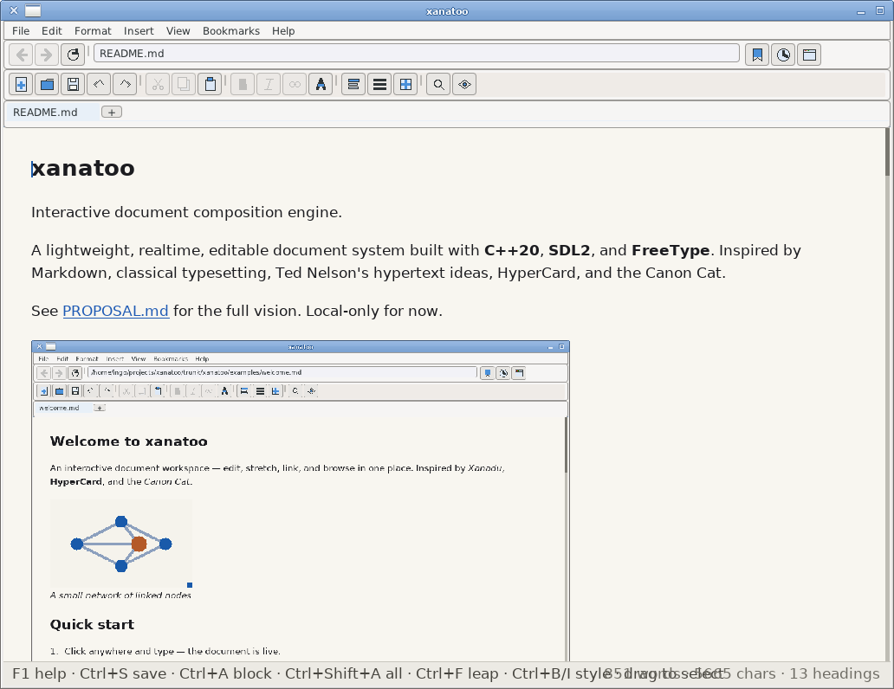

# xanatoo

**A document you can walk around in.**

xanatoo is a lightweight, native hypertext workspace: a live document editor,
reader, and explorer built with **C++20, SDL2, FreeType, and Dear ImGui**. It
draws inspiration from Ted Nelson's Xanadu and stretchtext, HyperCard, classical
typesetting, and the Canon Cat.

Edit a document directly on the page, unfold a detailed explanation, follow a
link to a particular passage, or read a web article and an ebook side by side.
Local files, imported books, feeds, and supported online services share one
semantic document model and layout engine. It is deliberately **not** a full
CSS/JavaScript web browser.



Website and downloads: **[xanatoo.github.io](https://xanatoo.github.io/)**.
For the original vision see [PROPOSAL.md](PROPOSAL.md); for the evolving design,
see [docs/BRAINSTORM.md](docs/BRAINSTORM.md) and [TODO.md](TODO.md).

## What it does

- **Write on the page.** Edit paragraphs, headings, lists, tables, code, links,
  figures, and notes without switching between source and preview. Reorder
  blocks, adjust columns and image sizes, and undo edits.
- **Follow passages, not just pages.** Expand/collapse stretchtext and sections;
  link to a named section or selected text; show just a passage (`//`), or
  navigate to and highlight it (`#`). Embed labelled passages with
  `:::include`, including from another local document.
- **Read your way.** Switch between scrolling and paged spreads (one to three
  columns), use section focus and the outline, toggle web reader mode, show
  footnotes in a bottom strip, and choose semantic S-expression style sheets.
- **Arrange the workspace.** Use tabs, two-pane browsing, movable/dockable
  document windows and panels, per-view Back/Forward history that restores
  reading positions and marks the link leading forward, bookmarks of text
  selections, and session restoration.
- **Explore written material.** Open HTML pages, Gemini capsules, RSS/Atom
  feeds, Wikipedia, Hacker News, Reddit, Lemmy, and Nostr in native document
  views. Search with a configurable engine list and browse a curated directory.
- **Read books and images.** Open EPUB, browse Standard Ebooks and Gutenberg,
  import many other formats through Pandoc, and view image collections in a
  zoomable lightbox. TeX math uses an OpenType MATH font when available.
- **Keep drafts.** Unsaved local edits are autosaved to a content-addressed
  SQLite revision store when enabled. Revert, reopen drafts, and continue where
  you left off without an automatic discard of unfinished work.

For a guided tour of actual document elements, open
[`examples/tour.md`](examples/tour.md) (also in **Help → Examples**).

## Run it

The easiest path on Linux with Nix flakes is:

```sh
nix run github:Grumbel/xanatoo
nix run github:Grumbel/xanatoo -- notes.md
nix run github:Grumbel/xanatoo -- wikipedia:Ted_Nelson
```

From a checkout:

```sh
nix build
./result/bin/xanatoo                       # opens the welcome document
./result/bin/xanatoo notes.md other.md     # two panes
./result/bin/xanatoo examples/tour.md
```

Or build with CMake and a C++20 compiler, SDL2, FreeType, and the libraries
required by the selected optional features (see `CMakeLists.txt`):

```sh
cmake -S . -B build -DXANATOO_THUMTOO=OFF
cmake --build build -j
./build/xanatoo examples/welcome.md
```

`--font PATH` selects a TTF/OTF face, followed by `XANATOO_FONT` and the normal
font search. Run `xanatoo --help` or `man xanatoo` for options, including
`--fullscreen`, `--geometry`, `--ui-scale`, and the directory overrides.

### Android and handhelds

The Nix flake also builds an **Android 5.0+ APK** and an **R36S/PortMaster**
package:

```sh
nix build .#xanatoo-android
nix build .#xanatoo-r36s-portmaster-zip
```

Android supports touch gestures and the system keyboard; on R36S, a gamepad
drives navigation, a software pointer, and an on-screen keyboard. See
[docs/ANDROID.md](docs/ANDROID.md) and [mk/r36s/README.md](mk/r36s/README.md).
Prebuilt development snapshots are linked on the
[website](https://xanatoo.github.io/#download).

## Documents, formats, and addresses

| Input | How xanatoo handles it |
| --- | --- |
| Markdown (`.md`), Org (`.org`) | Direct, editable semantic documents |
| S-expression (`.sexp`, `.glyph`, `.ss`) | Structured document form; editable and exportable |
| Local `.html`, HTTP(S) pages | Simplified semantic HTML, read-only; no CSS/JavaScript engine |
| Gemtext (`.gmi`, `.gemini`), `gemini://` | Native document parser and optional network client |
| RSS / Atom feeds | Read-only threads and entries |
| `wikipedia:`, `hn:`, `reddit:`, `lemmy:`, `nostr:` | Service-specific read-only document views |
| EPUB | Imported for reading; a native EPUB importer is available without Pandoc |
| DOCX, ODT, reStructuredText, LaTeX, and more | Read-only import through optional Pandoc |
| Images and `:::collection` | Inline/block images, cards, thumbnails, lightbox |

The document language includes headings/sections/articles, nested lists and
tasks, links and typed relations, tables, definition lists, figures, citations,
footnotes, margin asides, columns, transclusion, stretchtext, and `$…$` /
`$$…$$` TeX math. See [FORMAT.md](FORMAT.md),
[examples/tour.md](examples/tour.md), and [docs/MATH.md](docs/MATH.md).

Addresses can identify *part* of a document:

```text
notes.md#id:introduction       whole document, passage marked
notes.md//id:introduction      that section as the current view
notes.md#text:hypertext        selected text, marked in context
```

The `#text:` form accepts a richer quote/context selector as documented in
[docs/PASSAGES.md](docs/PASSAGES.md). Some advanced selectors (such as
image-region crops and clipped multi-block text ranges) are still planned;
see that document for their status. Source URLs and imported formats remain
read-only, with Save As offering an editable Markdown copy.

## Everyday controls

| Action | Shortcut |
| --- | --- |
| Open a file or address | **Ctrl+L** |
| Search in the current document / find next | **Ctrl+F** / **F3** |
| Search the web/services (choose engine) | **Ctrl+Alt+K** |
| Toggle split view | **Ctrl+\\** |
| Outline / page navigation panel | **Ctrl+Shift+O** / **Ctrl+Alt+P** |
| Bookmark a selection or page | **Ctrl+Shift+B** |
| Paged reading / web reader mode | **F8** / **F9** |
| Browse/edit mode | **F2** |
| Save / Save As / undo | **Ctrl+S** / **Ctrl+Shift+S** / **Ctrl+Z** |
| Keyboard reference | **F1** |

The menu bar and toolbar expose more commands: structure editing, dragging
blocks and column gutters, dockable windows, styles, bookmarks, collections,
and per-view reading options. See [examples/help.md](examples/help.md) for
the complete keyboard reference.

## Display and state

Style sheets (`styles/*.xss`) control *semantic roles*, not CSS selectors.
They can change typography, spacing, margins, side boxes, colours, and paper
backgrounds; reader preferences like zoom and paged mode stay separate from
the document. See [docs/STYLESHEETS.md](docs/STYLESHEETS.md).

| Data | Default location |
| --- | --- |
| Preferences (`view.conf`) | `$XDG_CONFIG_HOME/xanatoo/` |
| Drafts/revisions, folds, bookmarks, history, sessions | `$XDG_STATE_HOME/xanatoo/` |
| Your style sheets and search engines (`search.sexp`) | `$XDG_DATA_HOME/xanatoo/` |
| Images, thumbnails, downloads, imports | `$XDG_CACHE_HOME/xanatoo/` |

Use `--config-dir`, `--state-dir`, `--user-data-dir`, or `--cache-dir` to
redirect these. `--portable` keeps them under `userdata/` beside the
executable; `--no-save` disables persistent state, and `--new-session` skips
restoring the previous workspace. `--show-paths` prints the resolved paths.

## Development status and scope

xanatoo is experimental. The HTML reader prioritizes text structure over
browser fidelity: it does not execute JavaScript, apply site CSS, or support
interactive web forms. Several services rely on public APIs and may stop
working when those services change.

**Network security limitation:** the current OpenSSL and Mbed TLS backends
do **not yet verify peer certificates**. Do not use the built-in network
clients for sensitive information or authenticated browsing. Certificate
verification is an outstanding task.

The project follows [gamepkgstd](https://github.com/Grumbel/gamepkgstd)
where applicable, with editor-specific exceptions documented in the
implementation. The code and design notes live in:

- [docs/ARCHITECTURE.md](docs/ARCHITECTURE.md) — content, layout, interaction,
  and rendering;
- [docs/REVISIONS.md](docs/REVISIONS.md) — draft store and future identity;
- [docs/PASSAGES.md](docs/PASSAGES.md) — addresses, cuts, marks, and embeds;
- [docs/BRAINSTORM.md](docs/BRAINSTORM.md) — long-term hypertext direction;
- [TODO.md](TODO.md) — current status and open work.

## License

GPL-3.0-or-later. See [LICENSE](LICENSE).
