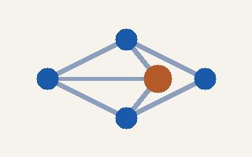
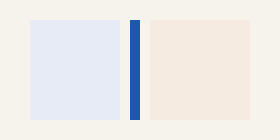
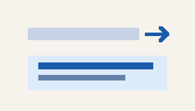

# Inline images and boxes

:::aside
**Aside.** A text box beside the flow, like HTML's `<aside>`. The style
sheet's `aside` role sets its width, side, fill and frame; the text
around it runs past and continues below. When the column gets too narrow,
the box drops into the flow at full width.
:::

Images can sit in running text: {width=24 height=24}
is an inline image, sized like the HTML `width` / `height` attributes. It
stands on the baseline and makes its line taller when it is higher than
the letters. The caret treats it as one character, so it can be typed
around, selected and deleted like a letter. A linked image
[{width=24 height=24}](columns.png) follows its link
on a click; an image without a link opens in the viewer.

Paragraphs beside a box are wrapped line by line: each line takes the room
the box leaves free, and once the text has passed the box it uses the
whole column again. Blocks with a box of their own — tables, code, block
images — start below a floating box instead of running under it.

| Mode | Picture | Notes |
|------|---------|-------|
| Columns | {width=48} | side-by-side text |
| Stretchtext | {width=48} | expands in place |
| Network | {width=48} | feeds, Gemini, Nostr |

:::aside side=left
A second box, on the left this time (`:::aside side=left`).
:::

The markup is plain: `{width=… height=…}` for an image inside
text, `` for a linked one, and a `:::aside` fence for a
box. A line that holds nothing but an image is still a block image.
In HTML, `<aside>` inside `<main>` or the article becomes such a box,
small icons and images in table cells or list items stay in the text.
