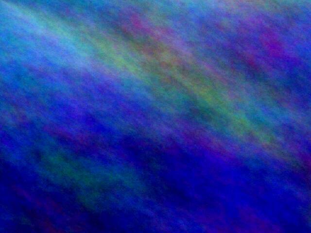
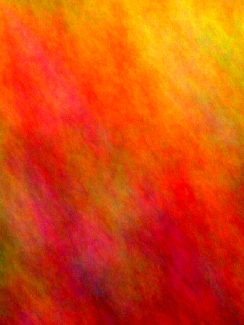
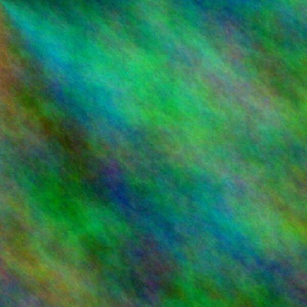
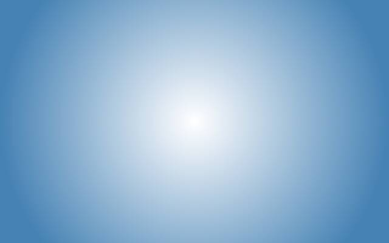
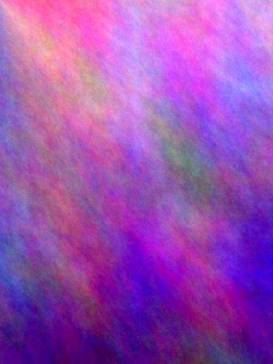
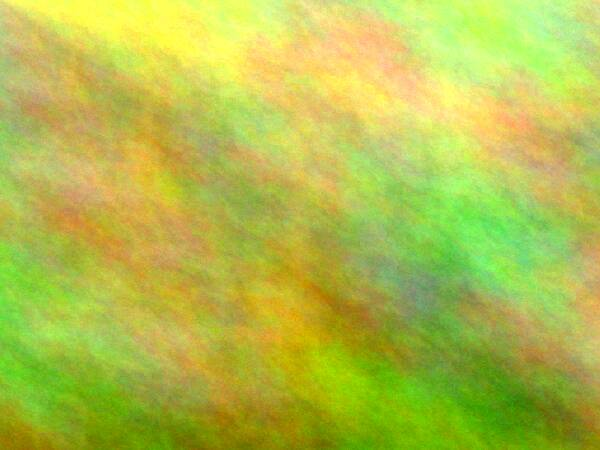
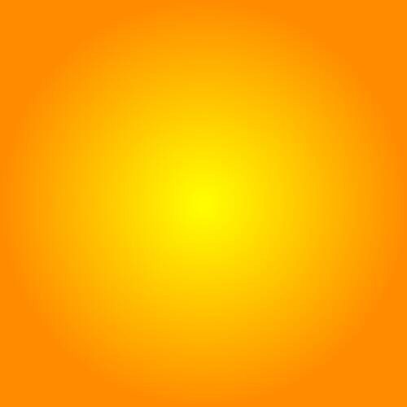

# Collections

A **collection** is an ordered set of images (or figures) that renders as
cards instead of full-size pictures. The collection is part of the
document; how it looks is a view setting. Right-click a card (or use
**View → Collection**) to switch between grid, list and full size, change
the card size or the sort order. Click a card to view the images
fullscreen: ←/→ steps, **F** toggles window fullscreen, **Esc** closes.

Thumbnails are never stored in the document: they are generated from the
originals and cached in the shared thumtoo tile cache (`~/.cache/thumtoo/`).

## Plain images

:::collection

:::

## Figures with captions, shown as a list

:::collection view=list
:::figure

A radial gradient — *sun*.
:::
:::figure

Plasma fractal in **ember** colours, portrait format.
:::
:::figure

Linear gradient, sky to sand.
:::
:::

Text after the collection continues as usual.
