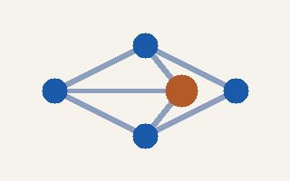
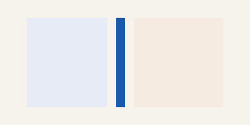
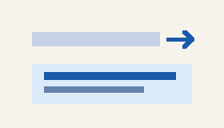
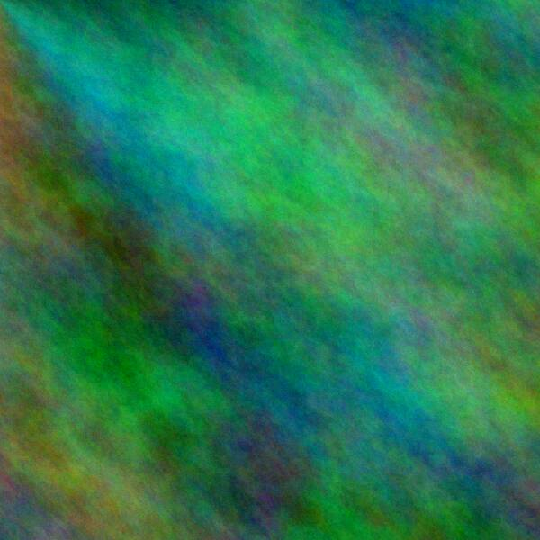
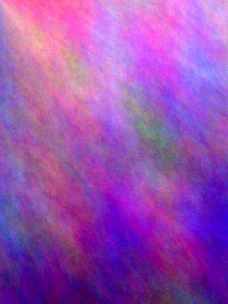
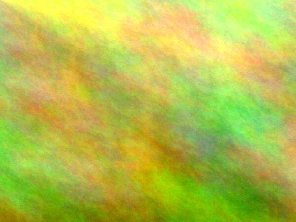

# A tour of xanatoo documents

This page shows everything a xanatoo document can hold, one feature after
the other. Edit it freely (**F2** leaves browse mode). Your changes are
kept as a draft and never overwrite the installed file. The outline
(**View → Outline**) lists the sections below.

:::aside
**Margin notes.** An aside is part of the text, so it belongs to the place
where it stands. It goes into the page margin beside that place, set
smaller and in a box. If the margin is narrow, the text column gives up
some width for it. If the window is too narrow for both, the box goes into
the text at full width.
:::

xanatoo is a markup browser, not a page layout engine. The document says
*what* each passage is: a heading, a note, a quotation, a discussion. The
style sheet (**View → Style sheet**) and the view settings decide how it
looks, so the same page reads well in a narrow window, on a phone, or with
the *Night* sheet.

## Running text

Inline markup covers *emphasis*, **strong** text, `code`, ~~struck out~~
words, [links](help.md) and typed links such as
[the keyboard reference](help.md){rel=glossary}. Links inside the page use
the heading's name: [jump to Tables](#Tables).

Images can sit in running text: {width=24 height=24}
is an inline image, sized like the HTML `width` / `height` attributes. It
stands on the baseline and makes its line taller when it is higher than
the letters. The caret treats it as one character, so you can type around
it, select it and delete it like a letter. A linked image
[{width=24 height=24}](columns.png) follows its
link when clicked. An image without a link opens in the viewer.

> A quotation is a block of its own. Long quotes keep their line breaks,
> and the style sheet sets them off with a bar.

---

## Structure

:::article id="structure"
:::header
Sections and articles
:::

A Markdown `#` title becomes a **header** without an h1–h6 rank. Depth
comes from nesting: a header inside two sections is deeper than one at the
top of an article. Group related paragraphs with `:::section` or
`:::article` so they stay one unit when you move, outline or export them.

:::section id="model"
:::header
The model
:::

- **Header**: the title of the enclosing section or article.
- **Section**: groups body blocks, and may nest.
- **Article**: a self-contained composition (essay, RFC, help chapter).

**Format → Structure → Wrap in Section** (`Ctrl+Shift+1`) or **Wrap in
Article** (`Ctrl+Shift+2`) wraps the block under the caret. `Ctrl+1` makes
a header.

:::section id="quotable"
:::header
A passage to quote
:::

Every labelled passage is addressable: this one is `tour.md#quotable`.
The *Transclusion* section below includes it by that name.
:::
:::
:::

## Lists and tasks

1. Numbered lists count by themselves.
2. Items can hold **inline** markup and
   [links](#Running-text).

- [x] Inline images
- [x] Margin boxes
- [ ] A side panel for page navigation

:::deflist
Stretchtext
: Text that expands in place when you ask for more detail.
Transclusion
: A passage shown inside another document and kept live.
:::

## Notes and code

:::note kind=tip
A note is a call-out set apart from the text: tips, warnings and remarks
the reader may skip.
:::

```cpp
// Code blocks keep their spacing and use the code face.
int main() { return run_frame(app); }
```

## Tables

| Mode | Picture | Notes |
|------|---------|-------|
| Columns | {width=48} | side-by-side text |
| Stretchtext | {width=48} | expands in place |
| Network | {width=48} | feeds, Gemini, Nostr |

Table cells hold inline markup and inline images, like the pictures above.
For a cell that spans columns or rows, use a fenced table:

:::table
:::row
:::th colspan=2
Reading modes
:::
:::
:::row
:::th rowspan=2
Page
:::
:::cell
One column
:::
:::
:::row
:::cell
Facing columns
:::
:::
:::

The first heading covers two columns; the second covers both rows. In an
S-expression table, write the same attributes as `:colspan 2` and `:rowspan 2`.

## Side boxes

:::aside side=left
A box in the left margin (`:::aside side=left`). Boxes on one side stack
and never overlap.
:::

The markup is plain: `{width=… height=…}` for an image inside
text, `[](href)` for a linked one, and an `:::aside` fence for a
box. A line that holds nothing but an image is still a block image.

The style sheet's `aside` role sets the width, side and look of the boxes.
Its `placement` is `margin` here. With `float`, a box instead sits inside
the column and the text runs past it, the way HTML floats work. With
`flow`, it always sits in the text.

On web pages, `<aside>` inside the article becomes such a box. Navigation
and side bars are page chrome: outside reader mode they go into the left
margin under a small label. Reader mode hides them.

## Stretchtext

:::stretch summary="Stretchtext: click to read more"
Ted Nelson's stretchtext changes the text as you read: a summary line
expands into the full passage, and the passage collapses again. The
document holds both. Expanding is a view choice and is not saved as an
edit.
:::

## Columns

:::columns
:::column
**Left column.** Columns set short passages side by side. When the window
gets too narrow, they stack.
:::
:::column weight=2
**Right column**, twice as wide (`weight=2`). Each column is a sequence of
ordinary blocks, so lists, images and notes work inside it as well.
:::
:::

## Figures and collections

:::figure
{scale=0.5}
A figure is an image with a caption, kept together as one block.
:::

A **collection** is an ordered set of images or figures, shown as cards.
How it looks is a view setting: right-click a card, or use **View →
Collection**, to switch between grid, list and full size, or to change the
card size and sort order. Click a card to view the images fullscreen: ←/→
steps, **F** toggles fullscreen, **Esc** closes. Thumbnails are never
stored in the document. They come from the shared thumtoo tile cache.

:::collection








:::

:::collection view=list
:::figure

A radial gradient: *sun*.
:::
:::figure

Plasma fractal in **ember** colours, portrait format.
:::
:::

## Image floats

A block image can sit at the left or right of the text column. The following
paragraphs wrap around each image; when the column is too narrow to leave a
readable text measure, the image takes its own line instead.

{width=150 float=left}

This image floats to the **left**. The text uses the remaining space beside
it, then returns to the full column below. A float belongs to the flow around
it, so keep the surrounding paragraphs long enough to show the wrap. Resize
the window or switch panes to see the layout adapt.

{width=150 float=right}

This one floats to the **right**. The same block image syntax works on either
side: add `float=left` or `float=right` to its attributes. The image remains a
block in the document; its float changes only how nearby lines flow around
it.

## Transclusion

The box below is not a copy. It shows the passage named `#quotable` from
the *Structure* section, and it changes when that passage changes.

:::include #quotable

## Discussion

Threads hold messages with an author, a date and a stable id. Replies
point at their parent with `in-reply-to`, and layout derives the
indentation from that. A message may also comment on a passage instead of
a person with `about="#…"`.

:::thread id="thread-include" subject="RFC: typed includes"

:::message id="m-alice-1" from="Alice Example <alice@example.org>" date="2026-02-28T09:14:00Z"
I keep wanting includes to say whether they are a **citation** or a
**live edit surface**, plus a short relation such as `normative`:

```
:::include other.md#API rel=normative mode=cite
```
:::

:::message id="m-bob-1" from="Bob Rivera <bob@example.org>" date="2026-02-28T10:02:11Z" in-reply-to="m-alice-1"
We already have typed links (`{rel=…}`). The same vocabulary for includes
would let one query find everything that claims to be normative about X.
:::

:::message id="m-cara-1" from="Cara Nguyen <cara@example.org>" date="2026-02-28T11:40:33Z" in-reply-to="m-alice-1"
Please do **not** put UI policy into the file. Cite or edit is a *view*
concern. The document should only record the target and a relation.
:::

:::message id="m-cara-2" from="Cara Nguyen <cara@example.org>" date="2026-03-01T12:18:00Z" about="#Discussion"
This message comments on the section, not on a person.
:::

:::message id="m-alice-2" from="Alice Example <alice@example.org>" date="2026-03-03T09:00:00Z" in-reply-to="m-cara-1"
Rough consensus, then:

| Topic | Decision |
|-------|----------|
| Include `rel` | Optional open string |
| Include `mode` | Not in the file |
| Threading | `in-reply-to` / `about` ids |
:::

:::

## Footnotes and citations

A footnote mark[^1] sits in the running text, and the note itself is
collected at the end of the page. Click a mark to jump to its note, or
hover over it for a preview. With **View → Footnote overlay**, the notes
of the marks on screen appear in a strip at the bottom of the pane.[^2]

Footnotes and margin notes answer the same question in two ways. A
footnote keeps the main line intact and puts the note out of the way,
while an aside stands right beside its passage.[^3]

Citations point into a bibliography:
[Nelson 1965](cite:nelson65) coined *hypertext*, and
[Raskin 1987](cite:raskin87) built the Canon Cat around leaping through
one long text.

:::biblio
[^nelson65]: Theodor H. Nelson. *A File Structure for the Complex, the Changing and the Indeterminate.* ACM National Conference, 1965.
[^raskin87]: Jef Raskin. *The Canon Cat.* Information Appliance, 1987.
:::

## Notes

[^1]: Like this one. Each note is addressable as `#fn:key`, so other
documents can link straight to it.

[^2]: The strip takes at most 40 % of the pane. A note that is already on
screen, or one that would cover the caret, is left out.

[^3]: A note may span several paragraphs.

    The next ones are indented by four spaces in the source.
