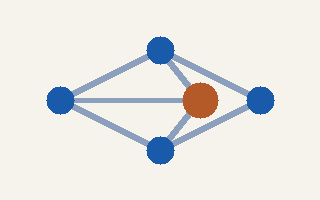
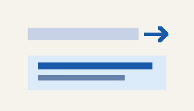
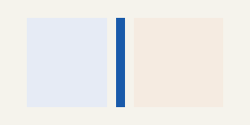

# Welcome to xanatoo

An interactive document workspace — edit, stretch, link, and browse in one place.
Inspired by *Xanadu*, **HyperCard**, and the *Canon Cat*.

{scale=0.85}

## Quick start

1. Click anywhere and type — the document is live.
2. **Enter** splits a paragraph; **Ctrl+Z** undoes.
3. Click a stretchtext marker (▸ / ▾) to expand or collapse.
4. Follow blue links: internal `#anchors`, other example files, or `gemini://`.
5. **F1** opens the full keyboard reference · **F2** toggles browse (read-only) mode.

:::stretch summary="Essential keys (expand for more)"
| Key | Action |
|-----|--------|
| **Ctrl+S** | Save |
| **Ctrl+O** / **Ctrl+L** | Open file / focus location bar |
| **Ctrl+F** | Leap search (F3 next) |
| **Ctrl+\\** | Dual-pane split |
| **Ctrl+T** / **Ctrl+W** | New tab / close tab |
| **Ctrl+Shift+P** | Pop out to floating window |
| **Alt+Left** / **Alt+Right** | History back / forward |
| **Ctrl+Shift+H** | Session history panel |
| **Ctrl+Shift+B** | Bookmark this page |
| **Ctrl+B** / **I** / **K** | Bold / italic / link |
| **F1** | Keyboard help document |

Menus: **Alt+F** File · **E** Edit · **V** View · **B** Bookmarks · **H** Help.
:::

## Example documents

Open any of these from this page (links load in the same pane and join session history):

### Guides

- [Keyboard reference](help.md) — complete keybinding list (**F1**)
- [Article / Section / Header](sectioning.md) — semantic sectioning model

### Demos

- [Thread / RFC discussion](thread-rfc.md) — Thread and Message nodes
- [Gemini gemtext sample](gemini-sample.gmi) — native gemtext layout
- [Nostr discussions](nostr-sample.md) — open `note1`/`nevent1` threads (Ctrl+L)
- [Org-mode sample](sample.org) — headings, TODO, tags, source blocks
- [Semantic format (S-expression)](semantic.sexp) — experimental sexpr form
- [Sample (S-expression)](sample.sexp) — compact sexpr demo

### Diff pair (open both for side-by-side marks)

- [Diff demo — version 1](diff-v1.md)
- [Diff demo — version 2](diff-v2.md)

Or use **View → Examples → Diff demo (v1 \| v2, marks on)** to load both panes at once.

:::columns
:::column weight=1.1
### Stretchtext

{scale=0.8}

Collapsed passages keep a one-line summary. Click the marker to expand; the layout reflows immediately.
:::
:::column
### Columns & images

{scale=0.8}

Drag column gutters to reweight widths. Drag an image’s blue corner to resize (`{scale=…}` is saved).
:::
:::

## Living relationships

Try an internal jump: [Quick start](#Quick start).

External web links open in your system browser: [Project Xanadu](https://en.wikipedia.org/wiki/Project_Xanadu).

With Gemini enabled, type a capsule in the location bar (**Ctrl+L**), for example:

`gemini://geminiprotocol.net/`

A live embedding of another passage on this page:

:::include #Quick start

## Design pillars

- Addressable passages and stable node IDs
- Stretchtext that reflows the living layout
- Side-by-side views of related material
- Direct manipulation of images and blocks
- Session history and bookmarks for local files and capsules

> “A document is not just something you render and read. It is a live workspace.” — the xanatoo proposal

---

Open **View → Examples** any time, or return here by opening `welcome.md` from the Examples menu.
